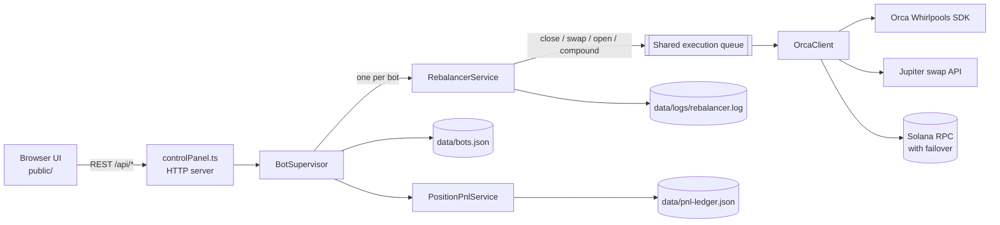

# Orca Multi-Bot LP Control Panel

A self-hosted TypeScript service that runs several concentrated-liquidity LP bots on [Orca Whirlpools](https://www.orca.so/) (Solana) from one shared wallet. It includes a browser control panel, a persistent PnL ledger, and crash-safe recovery for multi-step rebalances.

> **Experimental software that signs real mainnet transactions.** Read [Risks and limitations](#risks-and-limitations) before you point it at a funded wallet.

---

## Overview

Concentrated-liquidity pools only pay trading fees while the pool price stays inside your position's price range. A tight range earns more fees per dollar, but price leaves it more often, and every time that happens someone has to close the position, rebalance the two tokens and open a new range around the current price.

This project automates that loop for any number of Whirlpools at once:

1. **Monitor.** Each bot polls its pool price and compares it with the anchor (the centre of the current range).
2. **Decide.** It triggers a rebalance when price drifts past a threshold or leaves the on-chain range, filtered by confirmation polls and a cost/benefit check.
3. **Execute.** It closes the old position, swaps to the target token ratio through Jupiter and opens a new position centred on the current price.
4. **Account.** It records entry capital, fees earned, swap costs and network fees for every position in a JSON ledger.

All bots share one hot wallet. Each bot monitors its pool independently, and every wallet-changing action (close, swap, open, compound) goes through **one serialized execution queue**, so two bots never spend from the wallet at the same time.

## Features

**Multi-bot supervisor**
- Any number of bots, each with its own Whirlpool, USD allocation, range, drift trigger, poll interval and slippage settings
- Per-bot polling loops with random jitter, plus a single shared execution queue (its depth is shown in the UI)
- Token mints and decimals are discovered on-chain from the Whirlpool address when a bot is created
- Bots can be started, stopped, paused, resumed, edited and archived without restarting the process

**Rebalancing**
- Symmetric price band around the centre price: `[centre / (1 + r), centre × (1 + r)]`
- Drift trigger around the anchor price, plus an immediate trigger when price leaves the actual (tick-snapped) on-chain range
- Anti-whipsaw filter: drift must persist for `DRIFT_CONFIRM_POLLS` consecutive polls
- Heuristic cost/benefit gate (`REBALANCE_MIN_BENEFIT_MULTIPLE`, `0` = no minimum) that skips drift rebalances that probably cost more than they earn
- Swaps go through the Jupiter swap API to reach the value split the new range needs, followed by "strict" pre-open swaps until the wallet is within `OPEN_BALANCE_TOLERANCE_BPS` of the open target
- Per-bot allocation cap and a SOL reserve (`SOL_RESERVE_LAMPORTS`) kept back for transaction fees, which wallet-funding swaps respect too
- **Slippage ladder:**
  - **Close:** `MAX_SLIPPAGE_BPS`, then `CLOSE_RETRY_SLIPPAGE_BPS`, then `CLOSE_FINAL_RETRY_SLIPPAGE_BPS`, with `SLIPPAGE_RETRIES_PER_TIER` attempts per tier. It only moves to a wider tier on a token-minimum-subceeded error.
  - **Open:** each tier pairs a slippage value with a deployment buffer (base, retry, final). Repeated open failures start later attempts at a wider tier.

**Fee compounding**
- Optional per-bot compounding on a timer (`COMPOUND_INTERVAL_SECONDS`, `0` = off): it harvests accrued fees and adds them back into the same position
- Skipped when accrued fees are below `COMPOUND_MIN_QUOTE_VALUE` or don't cover the estimated harvest cost (`HARVEST_MIN_BENEFIT_MULTIPLE`)
- A manual "Compound" action in the UI skips both checks

**Recovery and resilience**
- Each rebalance is a persisted state machine (`closing → swapping → opening`), so a crash or restart resumes from the last confirmed phase
- Transaction confirmations time out after 45 s. The bot then reconciles against on-chain state to decide whether to continue, retry or pause.
- After an open timeout it adopts a single unclaimed position in the same pool, and it refuses to open a replacement while the previous position is still live
- Automatic, backed-off retries for simulation failures and recoverable RPC errors (rate limits, network errors, 5xx)
- Unresolvable or ambiguous states pause the bot with a human-readable reason and wait for a manual resume
- Legacy single-bot state (`BOT_STATE_FILE`) is migrated into the bot registry the first time the registry is created

**PnL ledger**
- One record per position: entry capital, live marks (refreshed about every 60 s from a simulated close quote), fees earned, swap costs and network fees in USD, plus realised PnL on close
- Per-bot and global totals: open, realised, total, fees earned, total deposited vs. withdrawn
- Ledger records with no matching live position are closed automatically. LP positions in the wallet that no record tracks are counted as "orphaned" and shown as a warning.
- USD conversion uses the pool directly when one side is USDC. Otherwise it goes through a SOL/USDC bot's price or a Jupiter SOL→USDC quote.

**RPC failover and observability**
- Primary RPC plus any number of fallbacks (`SOLANA_RPC_FALLBACK_URLS`). It rotates to the next endpoint on HTTP 408/409/425/429/5xx and on transport errors.
- For each close, swap and open the bot logs the signature, quote, fee in lamports, compute units, confirmation status and on-chain error, when the RPC returns them
- Structured JSON logs (pino) go to stdout and to `LOG_FILE`. The UI's transaction history is built from that log.

## Architecture



| Module | Responsibility |
|---|---|
| `src/controlPanel.ts` | HTTP server: static UI and JSON API; starts the supervisor |
| `src/panelAuth.ts` | Optional `UI_TOKEN` authentication: login form, session cookie, bearer header |
| `src/index.ts` | Single-pool CLI (`run`, `dry-run`, `rebalance-now`) |
| `src/config.ts` | Environment schema (zod) and defaults |
| `src/botConfig.ts` | Applies a bot's settings on top of the global config |
| `src/domain.ts` | Shared types: bot definitions, runtime state, pending rebalance, PnL records |
| `src/services/botSupervisor.ts` | Bot lifecycle, polling timers, shared execution queue, wallet summary |
| `src/services/rebalancer.ts` | Per-bot cycle: trigger logic, close/swap/open phases, compounding, recovery |
| `src/services/recovery.ts` | Pure helpers that classify timeouts as continue / retry / complete |
| `src/services/positionPnlService.ts` | Position ledger: open, mark, close, compound, reconciliation |
| `src/services/pnlMath.ts` | PnL aggregation and USD price resolution |
| `src/strategy/bands.ts` | Band, drift trigger and target-weight maths |
| `src/clients/orcaClient.ts` | All Orca SDK and Jupiter calls; transaction sending with timeout and RPC rotation |
| `src/clients/platformClient.ts` | Interface the Orca client implements |
| `src/infra/rpcAccountReader.ts` | Raw JSON-RPC wallet balance and token reads with failover |
| `src/infra/transactionInspector.ts` | Fee, compute-unit and token-debit extraction from confirmed transactions |
| `src/infra/rpcFailover.ts` | RPC URL list normalisation and recoverable-error detection |
| `src/state/*` | Atomic JSON stores for the bot registry, the PnL ledger and legacy state |

## Control panel

`npm run ui` starts the control panel and the multi-bot supervisor. It listens on `UI_HOST:UI_PORT`, which defaults to **`127.0.0.1:8787`**, so open `http://localhost:8787`.

**Authentication.** The panel can create bots, trigger swaps and close positions, so treat access to it as access to the wallet.
- Set `UI_TOKEN` to a long random secret (for example `openssl rand -hex 32`). The page then redirects to a login form; a correct token sets an `HttpOnly`, `SameSite=Strict` session cookie (an HMAC of the token, not the token itself). Scripts can send `Authorization: Bearer <token>` or `x-ui-token: <token>` instead. Every `/api` call without valid credentials gets `401`. Tokens are compared in constant time. *Sign out* in the top bar clears the cookie.
- Without `UI_TOKEN` the panel is unauthenticated, which is only reasonable on loopback. If `UI_HOST` is anything other than a loopback address and `UI_TOKEN` is unset, the panel prints a loud warning at startup.
- The panel speaks plain HTTP. If you reach it over a network, put it behind a VPN, an SSH tunnel or a TLS reverse proxy so the token isn't sent in clear text.

From the panel you can:
- Create a bot from a Whirlpool address, with allocation, range, drift, poll interval, and (under advanced settings) slippage tiers, deployment buffers, drift confirmation, cost/benefit multiples and compounding. The form is pre-filled from the server's env config (`GET /api/bot-defaults`), and any field left blank falls back to it.
- Start, stop, resume, rebalance now, compound now and archive each bot, and edit its main parameters
- View active LP positions, with a range indicator, and close a position manually
- See a wallet summary (address, token balances, total allocation, queue depth), global PnL KPIs and the position ledger
- Browse and filter transaction events (close, swap, deposit, compound, recovery, trigger) by bot, type, status or text

The page refreshes every 15 seconds.

<details>
<summary><strong>HTTP API</strong></summary>

When `UI_TOKEN` is set, every `/api` route needs the session cookie or an `Authorization: Bearer <token>` / `x-ui-token` header.

| Method | Path | Description |
|---|---|---|
| `GET` · `POST` | `/login` | Login form / submit the token (only when `UI_TOKEN` is set) |
| `GET` | `/logout` | Clear the session cookie |
| `GET` | `/api/status` | Wallet summary, bots and global PnL (cached for 5 s) |
| `GET` | `/api/bot-defaults` | Strategy defaults for new bots, from the env config |
| `GET` | `/api/bots` | List non-archived bots |
| `POST` | `/api/bots` | Create a bot (JSON body with `whirlpoolAddress`; omitted strategy fields use the defaults) |
| `PATCH` | `/api/bots/:id` | Update bot fields |
| `DELETE` | `/api/bots/:id` | Archive a bot |
| `POST` | `/api/bots/:id/start` · `/stop` · `/pause` · `/resume` | Lifecycle controls |
| `POST` | `/api/bots/:id/rebalance` | Force a rebalance cycle now |
| `POST` | `/api/bots/:id/compound` | Harvest and compound fees now |
| `POST` | `/api/bots/:id/close-position` | Close the bot's active position |
| `GET` | `/api/bots/:id/transactions` | Latest 60 events for one bot |
| `GET` | `/api/transactions[?botId=]` | Latest 100 events |
| `GET` | `/api/pnl` | PnL summary, per-bot summaries and all ledger records |

</details>

## Requirements

- Node.js **≥ 20.11** and npm
- A Solana mainnet RPC endpoint (a private or paid endpoint is strongly recommended; public endpoints rate-limit heavily)
- A **dedicated hot-wallet keypair** funded with the tokens you want to deploy, plus SOL for fees
- Optional: Docker for container deployment

## Setup

```bash
git clone <this-repo> && cd orca-farming-app
npm install
cp .env.example .env    # then edit .env
```

### Wallet

The bot signs transactions with a keypair file: a JSON array of 64 secret-key bytes in the format `solana-keygen` writes. Point `BOT_WALLET_KEYPAIR_PATH` at it.

- **Use a wallet created only for this bot.** Never use your main or browser wallet.
- When a bot is short of its allocation, it may swap **other tokens held in the wallet** into the pool's quote token (see [Risks](#risks-and-limitations)). Keep only what the bots should use in this wallet.
- **Never commit the keypair.** `.gitignore` and `.dockerignore` already exclude `wallet.json`, `*keypair*.json` and `.env`.

### Environment variables

The process loads `.env` with `override: true`, so values in `.env` take precedence over variables already set in the shell.

Defaults live in one place, `src/config.ts`, and `.env.example` lists every variable with exactly those values (a test keeps them in sync), so you only need to keep the lines you change. The strategy values below are used by the CLI and by a bot migrated from legacy state; the control panel also uses them as the pre-filled defaults for new bots and for any per-bot field missing from the registry.

**Core**

| Variable | Default | Description |
|---|---|---|
| `SOLANA_RPC_URL` | *(required)* | Primary RPC URL |
| `SOLANA_RPC_FALLBACK_URLS` | `""` | Comma-separated backup RPC URLs |
| `BOT_WALLET_KEYPAIR_PATH` | *(required)* | Path to the keypair JSON |
| `ORCA_WHIRLPOOL_ADDRESS` | *(required)* | Pool for the CLI / legacy bot. Must be non-empty even when you only use the panel. |
| `BOT_REGISTRY_FILE` | `./data/bots.json` | Bot definitions and runtime state |
| `BOT_PNL_LEDGER_FILE` | `./data/pnl-ledger.json` | Position PnL ledger |
| `BOT_STATE_FILE` | `./data/state.json` | Single-bot state (CLI) and legacy migration source |
| `LOG_FILE` | `./data/logs/rebalancer.log` | JSON log file (also feeds the UI's transaction history) |
| `LOG_LEVEL` | `info` | `fatal` · `error` · `warn` · `info` · `debug` · `trace` |
| `JUPITER_API_BASE_URL` | `https://lite-api.jup.ag/swap/v1` | Jupiter swap API base URL |
| `JUPITER_API_KEY` | `""` | Sent as `x-api-key` when set |

**Control panel**

| Variable | Default | Description |
|---|---|---|
| `UI_HOST` | `127.0.0.1` | Bind address. `docker-compose.yml` sets `0.0.0.0` inside the container. |
| `UI_PORT` | `8787` | Port |
| `UI_TOKEN` | `""` (no auth) | Shared secret required by the page and every `/api` call when set |

**Strategy**

| Variable | Default | Description |
|---|---|---|
| `BOT_ALLOCATION_USDC` | `0` | USD value to deploy (CLI / legacy bot). `0` means no cap. Panel bots always need an explicit allocation. |
| `RANGE_PCT` | `1` | Half-width of the LP band, in % |
| `REBALANCE_DRIFT_PCT` | `0.5` | Drift from the anchor that triggers a rebalance, in % |
| `POLL_SECONDS` | `15` | Price poll interval |
| `DRIFT_CONFIRM_POLLS` | `2` | Consecutive out-of-band polls required before a drift rebalance |
| `REBALANCE_MIN_BENEFIT_MULTIPLE` | `1.5` | Cost/benefit gate for drift rebalances: a drift rebalance goes ahead when the estimated fee benefit × this multiple covers the estimated swap + network cost. `0` disables the gate. Out-of-range and manual rebalances always bypass it. |
| `SOL_RESERVE_LAMPORTS` | `50000000` | SOL kept back for fees (0.05 SOL): never deployed when token A is SOL, and never spent by wallet-funding swaps |
| `MIN_SWAP_USDC` | `10` | Minimum value delta, in quote-token units, before a rebalance swap |
| `OPEN_BALANCE_TOLERANCE_BPS` | `25` | Allowed imbalance before opening |

**Slippage ladder and deployment buffers** (basis points)

| Variable | Default |
|---|---|
| `MAX_SLIPPAGE_BPS` (base tier, also used for Jupiter quotes) | `25` |
| `CLOSE_RETRY_SLIPPAGE_BPS` | `50` |
| `CLOSE_FINAL_RETRY_SLIPPAGE_BPS` | `100` |
| `OPEN_RETRY_SLIPPAGE_BPS` | `50` |
| `OPEN_FINAL_RETRY_SLIPPAGE_BPS` | `100` |
| `SLIPPAGE_RETRIES_PER_TIER` | `3` |
| `OPEN_DEPLOYMENT_BUFFER_BPS` | `50` |
| `OPEN_RETRY_DEPLOYMENT_BUFFER_BPS` | `150` |
| `OPEN_FINAL_DEPLOYMENT_BUFFER_BPS` | `300` |

**Compounding**

| Variable | Default | Description |
|---|---|---|
| `COMPOUND_INTERVAL_SECONDS` | `0` | Auto-compound interval; `0` disables it |
| `COMPOUND_MIN_QUOTE_VALUE` | `0.5` | Minimum accrued fees, in quote-token units, before compounding |
| `HARVEST_MIN_BENEFIT_MULTIPLE` | `2` | Fees must exceed the estimated harvest cost × this multiple (`0` disables the check) |

**Token pair** (CLI / legacy bot, and the token balances in the panel's wallet summary)

| Variable | Default |
|---|---|
| `TOKEN_A_MINT` / `TOKEN_A_SYMBOL` / `TOKEN_A_DECIMALS` | wrapped SOL / `SOL` / `9` |
| `TOKEN_B_MINT` / `TOKEN_B_SYMBOL` / `TOKEN_B_DECIMALS` | USDC / `USDC` / `6` |

## Usage

| Command | What it does |
|---|---|
| `npm run ui` | Start the control panel and the multi-bot supervisor. **This is the main entry point.** |
| `npm run run` | Single-pool CLI: loop on `ORCA_WHIRLPOOL_ADDRESS` every `POLL_SECONDS`, with live transactions |
| `npm run dry-run` | Single-pool CLI: one cycle with trigger evaluation and close/swap/open/compound quotes, sending no transactions |
| `npm run rebalance-now` | Single-pool CLI: one cycle that forces a rebalance (live) |
| `npm test` | Run the Vitest suite |
| `npm run typecheck` | Type-check without emitting |
| `npm run build` | Compile TypeScript to `dist/` |

The CLI commands drive one pool from the env settings and keep their state in `BOT_STATE_FILE`. They don't use the bot registry, the shared queue or the PnL ledger. Don't run the CLI and the panel against the same wallet at the same time: they don't coordinate.

> `dry-run` never sends a transaction: it logs the close, swap, open and compound steps it would take instead, and its client refuses any send as a backstop. If `BOT_STATE_FILE` holds a pending rebalance or a paused bot, it logs that recovery would resume and stops, because recovery only runs live. It still writes runtime state (last cycle, drift status, latest action) to `BOT_STATE_FILE`.

## Docker / Raspberry Pi deployment

The repo has a multi-stage `Dockerfile` (`node:20-bookworm-slim`), a GitHub Actions workflow and a `docker-compose.yml` for a low-maintenance ARM64 host such as a Raspberry Pi.

**CI** (`.github/workflows/build-and-push.yml`): every push to `main` runs `npm ci`, the type-check and the test suite, and only if they pass builds a `linux/arm64` image with Buildx and QEMU and pushes it to GitHub Container Registry as `ghcr.io/<owner>/<repo>:latest` and `:<commit-sha>`.

**Host** (`docker-compose.yml`):
- `orca-bot` runs the image with `.env` as its env file, sets `UI_HOST=0.0.0.0` so the panel listens on the container's interfaces, mounts `./data` for state and logs, mounts `./wallet.json` read-only and publishes port `8787`. The image's `CMD` is `node dist/src/controlPanel.js`, so the container runs the control panel and multi-bot supervisor (the same as `npm run ui`).
- `watchtower` polls the registry every 5 minutes and restarts the container on a new image, so a push to `main` reaches the Pi automatically. It reads `~/.docker/config.json` for registry credentials.

```bash
# on the host, next to docker-compose.yml
mkdir -p data
cp /path/to/bot-keypair.json wallet.json   # dedicated hot wallet
cp .env.example .env                       # edit; keep BOT_WALLET_KEYPAIR_PATH=./wallet.json, set UI_TOKEN
docker compose up -d
docker compose logs -f orca-bot
```

Then open `http://<host>:8787` and sign in with `UI_TOKEN`. Because the panel listens on all interfaces inside the container, **set `UI_TOKEN` in `.env`** (the panel warns at startup if you don't). For defence in depth, also restrict the port at the host, for example publish `"127.0.0.1:8787:8787"` and use an SSH tunnel or VPN (see [Control panel](#control-panel)).

Change the `image:` line in `docker-compose.yml` to point at your own registry namespace.

> To run the single-pool CLI loop in the container instead of the panel, override the command, for example with `command: ["node", "dist/src/index.js", "run"]` in the compose service. Nothing listens on port 8787 in that case.

## Testing

```bash
npm test          # vitest run
npm run typecheck
```

The suite runs offline. It uses temporary directories for the JSON stores, stub clients for the rebalancer and a stubbed Jupiter/RPC layer for the Orca client, so it needs no RPC or wallet. It covers:

| File | Area |
|---|---|
| `tests/bands.test.ts`, `drift.test.ts`, `replay.test.ts` | Band maths, drift trigger windows, price-replay triggering |
| `tests/benefit-gate.test.ts` | Rebalance cost/benefit gate, including `REBALANCE_MIN_BENEFIT_MULTIPLE=0` |
| `tests/recovery.test.ts` | Timeout classification helpers |
| `tests/rebalancer-recovery.test.ts` | Rebalance state machine: resume after timeouts, position adoption, simulation-failure retries, allocation deferral, pre-open swaps; dry-run guard (no sends from rebalance, recovery or compounding); cost/benefit gate in a full cycle |
| `tests/wallet-funding.test.ts` | Wallet-funding swaps: SOL reserve, quote failures recorded and skipped, swap failures propagated |
| `tests/bot-registry-store.test.ts` | Registry CRUD, archiving, legacy-state migration and per-bot defaults |
| `tests/env-example.test.ts` | `.env.example` lists every variable with the code defaults |
| `tests/panel-auth.test.ts` | `UI_TOKEN` auth: 401 without credentials, bearer/header/cookie login, loopback detection |
| `tests/escape-html.test.ts` | HTML escaping used by the control panel |
| `tests/pnl-math.test.ts` | PnL aggregation and USD price resolution |
| `tests/position-pnl-service.test.ts` | Ledger open/mark/close, basis repair, stale-record reconciliation |
| `tests/transaction-inspector.test.ts` | Token-debit extraction from transaction metadata |

CI runs the type-check and the suite before it builds the image.

## Project structure

```
.
├── src/
│   ├── controlPanel.ts        # HTTP server + supervisor bootstrap (npm run ui)
│   ├── index.ts               # single-pool CLI
│   ├── config.ts  botConfig.ts  domain.ts  logger.ts
│   ├── clients/               # OrcaClient (Orca SDK + Jupiter), PlatformClient interface
│   ├── infra/                 # RPC reads, failover, transaction inspection
│   ├── services/              # supervisor, rebalancer, recovery, PnL
│   ├── state/                 # JSON stores (registry, ledger, legacy state)
│   └── strategy/bands.ts      # range / drift / weight maths
├── public/                    # control panel (index.html, app.js, styles.css)
├── tests/                     # Vitest suites
├── Dockerfile  docker-compose.yml
├── .github/workflows/build-and-push.yml
└── .env.example
```

Runtime data (`data/bots.json`, `data/pnl-ledger.json`, `data/logs/`) is created on first run and is git-ignored.

## Risks and limitations

- **Real funds, mainnet only.** The Orca SDK is configured for Solana mainnet; there is no devnet or paper-trading mode beyond the single-pool `dry-run`. Bugs, bad parameters or RPC problems can lose money.
- **Impermanent loss.** Rebalancing a tight range locks in impermanent loss on every move. Fee income may not cover IL, swap slippage and network fees. Nothing here guarantees a profit.
- **Heuristic decisions.** The rebalance cost/benefit gate and the harvest cost estimate are rough approximations, not fee forecasts.
- **Wallet-wide funding swaps.** If the bot's two tokens are worth less than its allocation, it may swap other assets in the wallet into the quote token through Jupiter, including SOL above `SOL_RESERVE_LAMPORTS`. Sources that can't be quoted are skipped and logged; a failed funding swap stops the rebalance and goes through the normal retry/pause handling. Use a dedicated wallet.
- **Control panel access.** Authentication is a single shared token (`UI_TOKEN`) over plain HTTP, and it is off unless you set it. Keep the panel on loopback, or behind a VPN / TLS proxy with a token set (see [Control panel](#control-panel)).
- **Hot key on disk.** The keypair is a plaintext file readable by the process.
- **Approximate PnL.** Values come from simulated close quotes and best-effort USD pricing. Treat them as estimates, not accounting records.
- **External dependencies.** Correct behaviour depends on the Orca SDK, the Jupiter swap API and your RPC provider. Changes or outages upstream can pause bots.
- **Single process.** The execution queue lives in memory, so one panel process should own a given wallet.
- **Symbol display.** Token symbols are only recognised for SOL and USDC; other mints show a shortened address.

This is a personal project, not financial advice. Use it at your own risk.

## License

No license file yet — all rights reserved.
